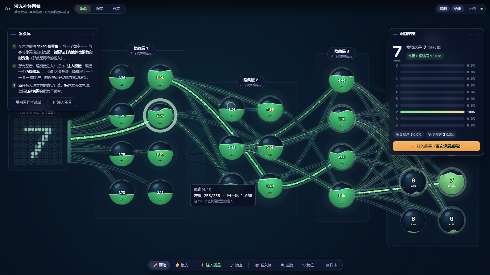
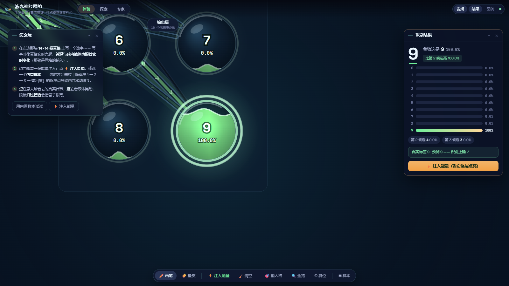
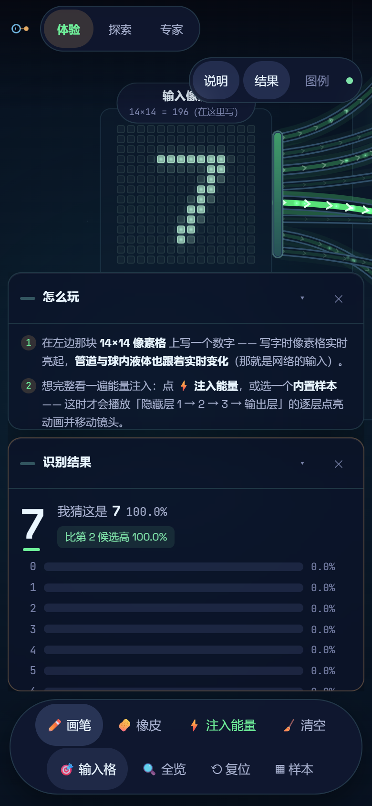

# 液光神经网络 · 手写数字实验室

**简体中文** ｜ [English](#english)

[](https://github.com/Eqarx/liquid-neural-lab/actions/workflows/deploy.yml)
[](LICENSE)
[](https://eqarx.github.io/liquid-neural-lab/)
[](#测试)
[](#模型与数据)

在 **14×14 像素格**上亲手写一个数字，看能量沿着**玻璃管道**逐层注入球体里的液体，一路点亮到输出层。

> 这不是动画演示，也不是预设结果的网页原型 —— 页面里跑着一个**真实训练过的 MLP 神经网络**
> （196 → 96 → 64 → 48 → 10，MNIST 测试集 **97.91%**），全部推理在浏览器本地完成。
> 球里的液体高度、管道的粗细与亮度、输出球上的百分比，都是真实前向传播算出来的数。



## 目录

- [真实 vs 示意](#真实-vs-示意)
- [特性](#特性)
- [快速开始](#快速开始)
- [测试](#测试)
- [目录结构](#目录结构)
- [模型与数据](#模型与数据)
- [性能](#性能)
- [部署（免费）](#部署免费)
- [许可](#许可)
- [已知限制](#已知限制)

## 真实 vs 示意

| | 真实 | 示意 |
|---|---|---|
| 计算 | 全部 196→96→64→48→10，**28,512 条连接**无一省略 | — |
| 数值 | 激活值、正向贡献 w·a、Softmax 概率、准确率 | — |
| 画面 | — | 每层只画**最活跃的 8 / 6 / 4** 个神经元（共 28 个玻璃球）与**58 根**主通道 |

为什么要这样：把 28,512 条连线全画出来既看不清也跑不动。插图画的是**拓扑示意**，数字是真的 ——
这一点在引导页、图例、探索面板、专家面板四处都写明了，专家面板里仍可查到完整架构与真实的 28,512 这个连接数。

两条容易误会的规则也写在图例里：

- **管道亮度 = 正向推动**（`max(0, w·a)`）。负权重是在**抑制**该数字，画成深灰"空管"；画面上"最亮的来路"因此必然通向答案。
- **液体高度**做了层内归一化与非线性压缩（`x^0.62`，封顶 0.82），否则每个球都会灌满、看不出差别。
- **空画板时整条链路全暗**，并且不给预测（偏置会让网络在空输入下瞎猜一个数字，那没有教学意义）。

## 特性

- **真实模型**：MNIST 训练，测试集 **97.91%**（10,000 张，未参与训练）；抖动增强测试集 97.34%
- **真实输入**：手写 → 8-bit 量化的 14×14 灰度（与训练端逐位一致，误差 < 1e-6），不裁剪不居中 —— 所见即所算
- **实时能量**：写字时管道粗细/亮度与球内液面**跟着笔画实时变化**，镜头不动
- **按需播放注入动画**：点「⚡ 注入能量」或选一个**内置样本**，才播放逐层点亮动画 ——
  每一拍都把镜头对准该层**激活最强的球**，注入波优先走通向它的管道，最后一拍锁在**获胜数字**上并留下脉冲环
- **竖列玻璃球**：每层竖向排列（8 / 6 / 4 / 10 个；隐藏层 3 是 1 列 4 个），球径 192px，管道近乎水平地成束流动
- **物理交互层**：拖球体（弹簧 + 邻域"膜"带动 + 液面倾斜晃荡）、拖层标签整层位移、鼠标扫过**拨弯管道**
- **触控板友好**：双指滚动 = 平移（文档语义）｜捏合 / Ctrl+滚轮 = 缩放｜传统鼠标滚轮 = 只缩放（按手势会话自动区分设备）
- **触屏 / 平板友好**：单指作画、轻点落子、两指捏合缩放与拖动平移（1:1 跟手）；触摸目标 ≥44px、
  避开 iPhone 安全区、禁用下拉刷新与长按菜单、触摸不产生悬停浮层
- **一键复位（等同刷新页面）**：浮窗位置与开关、折叠状态、镜头、设置值、球与管道全部恢复初始；**保留你的手写**
- **三级渐进式界面**：体验（写/看/点）→ 探索（能量流亮度、粒子、级联速度、检查器）→ 专家（架构表、公式、参数、实时性能）
- **可访问性**：reduced-motion 分级降级（Tier1 移除粒子与拨动、Tier2 瞬时过渡）、ARIA 标注、键盘可达
- **文案与权重不脱节**：架构、连接数、准确率全部由 `manifest.json` / `metrics.json` 推导，界面里没有写死的数字
- **纯前端**：无后端、无 API Key，`base: './'` 可静态部署到任意子路径

| 级联终点锁定获胜数字 | 手机触屏手写 |
|---|---|
|  |  |

## 快速开始

```bash
pnpm install        # 需要 Node ≥ 18、pnpm（本仓库用 pnpm 11）
pnpm dev            # http://localhost:5173
pnpm build          # tsc + vite → dist/
pnpm preview        # 本地预览构建产物
pnpm test           # 单元测试（数值等价 + 输入管线一致性，9 项）
pnpm check          # 仅类型检查
pnpm smoke          # 桌面冒烟测试（Playwright + 系统 Edge）
pnpm smoke:mobile   # 移动端冒烟
pnpm smoke:reduced  # reduced-motion 冒烟
pnpm audit          # 量化视觉审计（需先 pnpm dev）
pnpm train          # 重新训练模型（numpy，需自备 MNIST）
pnpm gradcheck      # 反向传播梯度自证（float64 中心差分）
```

模型权重随仓库提供（`public/models/digit-mlp14/weights.bin`，114,920 字节），**开箱即用、无需训练**。

## 测试

| 类别 | 命令 | 结果 |
| --- | --- | --- |
| 单元测试（TS 前向 vs Python 夹具、输入管线、下采样） | `pnpm test` | **9/9 通过**（前向最大误差 2.86e-6，预测 64/64 一致） |
| 冒烟测试（桌面 / 移动 / reduced-motion） | `pnpm smoke*` | **三端全部 PASS**，控制台错误 0 |
| 量化视觉审计（34 项像素与物理判据） | `pnpm audit` | **PASS** |
| 触控板 / 触屏适配（22 项） | `node tmp/check-touch.mjs` | **PASS** |
| 生产构建 + 静态部署 | `pnpm build && pnpm preview` | **PASS**（无调试钩子路径下真实推理成功） |

数值、性能与已知限制的完整清单见 [docs/测试结果.md](docs/测试结果.md)。

## 目录结构

```
├─ public/models/digit-mlp14/   # weights.bin + manifest + 内置样本 + metrics
├─ scripts/
│  ├─ train_digit_mlp.py        # numpy 训练（与前端逐位一致的 14×14 预处理）
│  ├─ gradcheck.py              # float64 中心差分梯度校验（反向传播自证）
│  ├─ smoke.mjs                 # 冒烟测试：桌面 / --mobile / --reduced（+ --shots 截图）
│  ├─ audit.mjs                 # 量化视觉审计：像素级判据 + 物理量判据
│  └─ fetch_fonts.mjs           # 自托管字体下载
├─ src/
│  ├─ core/                     # model（N 层前向）/ inputGrid（像素格）/ quant（8-bit 半偶舍入）/ assets
│  ├─ render/lab/               # 交互层：geometry（示意布局）/ schematic（选哪些节点与管道）/
│  │                            #   nodes（玻璃球+液体+弹簧）/ pipes（管道+流动箭头+拨动）/
│  │                            #   flow（能量光团）/ scene（绘制与手势）/ camera / palette
│  ├─ motion/                   # 共享帧循环、弹簧、reduced-motion
│  ├─ state/                    # lab.ts 引擎单例（真实推理 + 示意计划）/ useLab.ts
│  └─ components/               # 画布舞台、浮窗、结果 HUD、工具条、检查器、专家面板、说明卡
├─ tests/model.test.ts          # 对照 Python 夹具的数值等价测试
├─ docs/测试结果.md              # 测试结果、性能数据、已知问题与修复记录
├─ docs/部署到-GitHub-Pages.md   # 免费部署步骤（中英）
├─ assets/                      # README 用截图
└─ .github/workflows/deploy.yml # GitHub Pages 自动部署
```

## 模型与数据

- **架构**：196（14×14）→ 96（ReLU）→ 64（ReLU）→ 48（ReLU）→ 10（Softmax），**28,730 个参数 / 28,512 条连接**
- **训练**：`scripts/train_digit_mlp.py`（纯 numpy，无深度学习框架）
  - SGD + 动量 0.9、梯度裁剪 5.0、余弦学习率（warmup → 0.06 → 0.002）、He 初始化
  - 强增强：缩放 0.85–1.15、平移 ±2px、膨胀 p=0.30、模糊 p=0.25、亮度 0.60–1.0；第 50 轮起切换为轻抖动微调
  - 70 轮训练，验证集取训练集尾部 5,000 张，早停耐心 14；最佳验证准确率 98.20%
  - `scripts/gradcheck.py` 用 float64 中心差分验证反向传播（最大相对误差 1.5e-7）
- **数据**：MNIST（Yann LeCun、Corinna Cortes、Christopher Burges，**CC BY-SA 3.0**）
- **复现**：把 MNIST 放到 `tmp/mnist/` 后运行 `pnpm train`

## 性能

| 指标 | 数值 |
| --- | --- |
| JS 帧耗时（场景更新 + 绘制命令） | 1.0 – 2.5 ms |
| 应用渲染成本（对比空转基线） | ≈ **1.5 ms/帧** |
| 同机对照：改造前（28,512 条连线全画） | 29 – 51 fps，JS 帧耗时 3.4 – 4.5 ms |

优化手段：拓扑从 28,512 条线降为 58 根管道；管道分"点亮 / 空管"两条渲染分支；
能量光团只在点亮的管道上生成、拖尾按颜色批量描边；玻璃球渐变按需创建；
DOM 层标签只在渲染循环里写 `transform`，不触发 React 重渲染。

## 部署（免费）

三步上线，所需文件已备好（[详细步骤（中英）](docs/部署到-GitHub-Pages.md)）：

1. 在 GitHub 新建 public 仓库 `liquid-neural-lab`，推送本仓库（`.gitignore` 已排除 `node_modules/`、`dist/`、`tmp/`、`backups/`）
2. 仓库 **Settings → Pages → Source** 选 **GitHub Actions**
3. 等 `Deploy to GitHub Pages` 跑完 → 访问 `https://eqarx.github.io/liquid-neural-lab/`

`base: './'` 用相对路径，因此部署到 `用户名.github.io/仓库名/` 子路径无需改配置。
其它免费方案（Cloudflare Pages / Netlify / Vercel / Render）都只需构建命令 `pnpm build`、产物目录 `dist`。

## 许可

代码以 [MIT](LICENSE) 发布。第三方资源（MNIST **CC BY-SA 3.0**、Space Grotesk / JetBrains Mono **OFL 1.1**、
React / d3 / Vite 等）的许可见 [THIRD-PARTY.md](THIRD-PARTY.md)。

## 已知限制

1. **画面是示意拓扑**：每层只画最活跃的 8/6/4 个神经元与 58 根主管道，真实计算仍用全部 96/64/48 与 28,512 条连接（数值都是真的）。
2. **单数字分类器**：写多个数字、涂鸦或复杂背景时输出不可靠 —— 这是模型能力的真实边界。
3. **手写风格差异**：模型在 MNIST 风格上训练，过细、断笔、倾斜过大的手写准确率会低于 97.91%（真实的域偏移，可用于教学）。
4. **只读模型**：不包含浏览器内训练；专家面板中的参数只读。
5. **粒子是动画示意**：光团表示计算顺序与能量注入，网络内部没有真的粒子在传输。
6. **窄屏"全览"可读性有限**：手机竖屏下整张网络会缩得很小，建议用「输入格 / 隐藏层 / 输出层」逐层查看。

完整清单（含 Windows 开发环境、字体子集等）见 [docs/测试结果.md](docs/测试结果.md) 第 6 节。

---

<a id="english"></a>

# Liquid Neural Lab — handwritten digit visualizer

[简体中文](#液光神经网络--手写数字实验室) ｜ **English**

[](https://github.com/Eqarx/liquid-neural-lab/actions/workflows/deploy.yml)
[](LICENSE)
[](https://eqarx.github.io/liquid-neural-lab/)

Draw a digit on a **14×14 pixel grid** and watch energy flow through **glass pipes** into liquid-filled
spheres, layer by layer, until it reaches the output.

> This is not a canned animation: a **real trained MLP** (196 → 96 → 64 → 48 → 10, **97.91%** on the
> MNIST test set) runs entirely in your browser. Liquid levels, pipe widths/brightness and the output
> percentages are all computed by a real forward pass.


## Real vs. schematic

| | Real | Schematic |
|---|---|---|
| Computation | All 196→96→64→48→10, **28,512 connections**, nothing skipped | — |
| Values | Activations, positive contributions w·a, softmax probabilities, accuracy | — |
| Rendering | — | Only the **8 / 6 / 4 most active neurons** per layer (28 glass spheres) and **58 main pipes** |

Drawing all 28,512 edges is both unreadable and slow, so the topology is illustrative while the numbers stay real.
This is stated in the intro card, the legend, the explore panel and the expert panel — and the expert panel still
reports the true architecture and the real 28,512 connection count.

Display rules that are easy to misread (also stated in the legend):

- **Pipe brightness = positive drive** `max(0, w·a)`. Negative weights *inhibit* a digit and are drawn as dark
  "empty pipes", so the brightest path always leads to the answer.
- **Liquid level** is normalized per layer and softly compressed (`x^0.62`, capped at 0.82) — otherwise every
  sphere would look full.
- **An empty canvas shows no energy and no prediction** (the bias would otherwise make the net guess randomly).

## Features

- **Real model**: MNIST, 97.91% test accuracy (10k held-out images); 97.34% on a jitter-augmented test set
- **Real input**: strokes → 8-bit quantized 14×14 grayscale (bit-identical to the training pipeline, error < 1e-6)
- **Live energy**: pipe width/brightness and liquid levels follow your strokes in real time, camera stays put
- **On-demand injection animation**: press **⚡ Inject energy** or pick a built-in sample — each beat aims the
  camera at that layer's hottest sphere and locks onto the **winning digit** at the end
- **Vertical glass spheres**: 8 / 6 / 4 / 10 per layer (192px diameter), pipes flow in near-horizontal bundles
- **Physics layer**: drag spheres (springs + membrane + sloshing liquid), drag layer chips, sweep the mouse to **pluck pipes**
- **Trackpad friendly**: two-finger scroll pans (document semantics), pinch / Ctrl+wheel zooms, classic wheel zooms only
- **Touch / tablet friendly**: draw with one finger, tap to place a dot, pinch-zoom and two-finger pan (1:1),
  ≥44px touch targets, safe-area aware, no pull-to-refresh, no long-press menu, no sticky hover tooltips
- **One-key reset** (like a page refresh): panel layout, camera, settings, spheres and pipes — your drawing is kept
- **Three progressive UI levels**: experience → explore → expert (architecture, formulas, params, live perf)
- **Accessibility**: graded reduced-motion support, ARIA labels, keyboard-reachable controls
- **Pure frontend**: no backend, no API key, `base: './'` deploys to any sub-path

## Quick start

```bash
pnpm install     # Node ≥ 18 and pnpm (this repo uses pnpm 11)
pnpm dev         # http://localhost:5173
pnpm build       # tsc + vite → dist/
pnpm preview     # preview the production build
pnpm test        # unit tests: numerical equivalence + input pipeline (9)
pnpm check       # type-check only
pnpm smoke       # desktop smoke test (Playwright + system Edge)
pnpm audit       # quantitative visual audit (needs pnpm dev running)
```

Model weights ship with the repository (`public/models/digit-mlp14/weights.bin`), so it runs out of the box.

## Testing

| Kind | Command | Result |
| --- | --- | --- |
| Unit tests (TS forward vs. Python fixtures, input pipeline) | `pnpm test` | **9/9 pass** (max forward error 2.86e-6, 64/64 predictions match) |
| Smoke tests (desktop / mobile / reduced-motion) | `pnpm smoke*` | **all pass**, 0 console errors |
| Quantitative visual audit (34 checks) | `pnpm audit` | **pass** |
| Trackpad / touch adaptation (22 checks) | `node tmp/check-touch.mjs` | **pass** |
| Production build + static hosting | `pnpm build && pnpm preview` | **pass** |

Full numbers and known limitations: [docs/测试结果.md](docs/测试结果.md) (Chinese).

## Model & data

- **Architecture**: 196 (14×14) → 96 → 64 → 48 → 10, ReLU hidden layers + softmax, **28,730 params / 28,512 connections**
- **Training**: `scripts/train_digit_mlp.py`, plain numpy — SGD + momentum 0.9, gradient clipping 5.0,
  cosine LR (warmup → 0.06 → 0.002), He init, heavy augmentation, 70 epochs with a light-jitter fine-tune phase
- **Backprop self-check**: `scripts/gradcheck.py` (float64 central differences, max relative error 1.5e-7)
- **Data**: MNIST (LeCun, Cortes, Burges) — **CC BY-SA 3.0**. See [THIRD-PARTY.md](THIRD-PARTY.md)

## Deployment (free)

1. Create a public repo `liquid-neural-lab` and push (`.gitignore` already excludes `node_modules/`, `dist/`, `tmp/`, `backups/`)
2. Repo **Settings → Pages → Source: GitHub Actions**
3. Wait for the `Deploy to GitHub Pages` workflow → visit `https://eqarx.github.io/liquid-neural-lab/`

Step-by-step guide (bilingual): [docs/部署到-GitHub-Pages.md](docs/部署到-GitHub-Pages.md).
Cloudflare Pages / Netlify / Vercel / Render work too — build command `pnpm build`, output directory `dist`.

## License

Code: [MIT](LICENSE). Third-party notices (MNIST CC BY-SA 3.0, Space Grotesk & JetBrains Mono under OFL 1.1,
React / d3 / Vite): [THIRD-PARTY.md](THIRD-PARTY.md).
